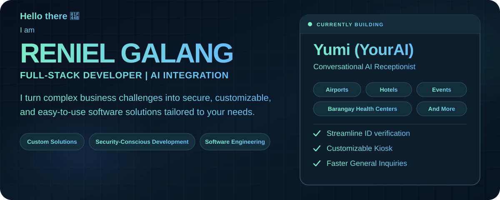
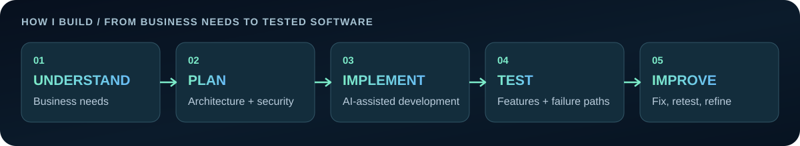

  

## Tech Stack

| Area | Technologies and methods |
| :--- | :--- |
| **Languages** | Python · Java · C/C++ · JavaScript · TypeScript · SQL |
| **Frontend & UI Tools** | React · Next.js · Tailwind CSS · Vite · JavaFX · HTML · CSS |
| **Backend & Databases** | Supabase · PostgreSQL · MySQL · Firebase · Pinecone · Prisma ORM · REST APIs · JDBC |
| **AI Platforms & Runtimes** | Microsoft Foundry · ElevenLabs Agents · D-ID Studio · GroqCloud · Ollama |
| **AI Integration & Automation** | Knowledge Bases · System Prompts · Whisper · Speech-to-text · Text-to-speech · n8n |
| **Testing & Security** | Playwright · Vitest · pytest · Supabase Row Level Security · Cloudflare Turnstile · WAF |
| **Development & Deployment Tools** | Git · GitHub · Docker · Vercel · OpenAI Codex · Claude Code |
| **Embedded & IoT** | Raspberry Pi · Arduino · ESP32-S3 · MQTT · BLE · Wi-Fi |
| **Firmware & Interfaces** | Finite-state machines · GPIO · UART · I²C · SPI · NFC · GPS |
| **Computer Vision** | OpenCV · YOLOv8 |

## Selected Projects

### 01 / CalorieCheck — Nutrition Tracker

`JavaScript / TypeScript` `Vite` `Supabase / PostgreSQL` `Turnstile` `Vercel`

[Staging demo](https://calorie-calculator-gamma-ten.vercel.app/) · [Repository](https://github.com/Reniel-Relearn/calorie-calculator)

- **Problem:** Move from one-off calorie estimates to personal food tracking with protected user records.
- **My contribution:** Defined requirements, guided AI-assisted implementation, configured authentication and database access policies, integrated Turnstile, and manually tested workflows.
- **Result:** Deployed a mobile-first staging prototype with calorie calculations, accounts, and food logs; conducted usability validation with **three users**.

### 02 / EZ Kyosk — Self-Ordering Kiosk

`React` `JavaScript` `Vite` `Vitest` `Playwright`

[Live web prototype](https://reniel-relearn.github.io/EZ-Kyosk/) · [Repository](https://github.com/Reniel-Relearn/EZ-Kyosk)

- **Problem:** Give cafés, bakeries, and restaurants a focused self-ordering experience.
- **My contribution:** Defined architecture, customer journeys, technology choices, deployment requirements, and acceptance criteria; coordinated AI-assisted implementation and manually tested ordering.
- **Result:** Helped deliver a functional prototype in **one day** and identified **two defects** that were fixed. POS hardware and payment-gateway integration remain pending.

### 03 / AFCS — Automated Fare Collection System

`Python / JavaScript` `Raspberry Pi` `NFC / GPS` `Firebase` `REST APIs`

[Repository](https://github.com/Reniel-Relearn/capstone-design-project-AFCS) · Academic capstone

- **Problem:** Connect fare calculation, authentication, location, seat allocation, hardware, and passenger/driver/admin interfaces.
- **My contribution:** Led a **five-member team**, developed embedded software, integrated hardware and cloud services, and troubleshot GPS instability through circuit, wiring, and satellite-acquisition software changes.
- **Result:** Executed tests across **21 categories** and consolidated **2,188 results**; **2,156 passed (98.54%)**.

### 04 / LaundryLink — Laundry Shop Management

`Java` `JavaFX` `JDBC` `MySQL`

[Team repository](https://github.com/stagnantwater69/LaundryLink)

- **Problem:** Keep a shared desktop application and its relational database consistent during team development.
- **My contribution:** Executed schema migrations across **eight tables and one view**, coordinated AI-assisted implementation of the Services and Prices module, and performed acceptance testing.
- **Result:** Identified an order-status usability defect and retested a teammate's correction to confirm resolution.

<strong>More Projects</strong>

**Applied AI & Software**

1. [Company Policy Assistant](https://github.com/Reniel-Relearn/company-policy-assistant) — Azure AI Foundry and a policy knowledge base.
2. [AI Audio Threat Detector](https://github.com/Reniel-Relearn/ai-audio-threat-detector) — Bilingual transcription with faster-whisper and local analysis with Ollama; Pydantic validates structured results for human review.
3. [Life Creation](https://github.com/Reniel-Relearn/life-creation) — Python survival game.
4. [CEO KPI Dashboard](https://github.com/Reniel-Relearn/ai-kpi-dashboards-showcase) — Executive analytics prototype with a grounded chatbot; Vercel AI SDK handles model integration, Zod defines AI-tool input schemas, and Prisma handles database access.

**Embedded Systems & IoT**

1. [ATM Banking System](https://github.com/Reniel-Relearn/atm-banking-system)
2. [PanahonCheck](https://github.com/Reniel-Relearn/panahoncheck-weather-monitoring)
3. [Smart Glass Helmet](https://github.com/Reniel-Relearn/smart-glass-helmet)
4. [Wearable Air Quality Detector](https://github.com/Reniel-Relearn/wearable-air-quality-detector)
5. [Anti-Theft Bag Alarm](https://github.com/Reniel-Relearn/anti-theft-bag-alarm)
6. [Smart Door Status Indicator](https://github.com/Reniel-Relearn/smart-door-status-indicator)
7. [Intruder Alert System](https://github.com/Reniel-Relearn/intruder-alert-system)

**Coursework**

1. [Digital Signal Processing](https://github.com/Reniel-Relearn/dsp-matplotlib-activities) — Signal generation and processing with NumPy and Matplotlib.
2. [Assembly Lab Exercises](https://github.com/Reniel-Relearn/assembly-lab-exercises)

## How I Build

I define specifications and acceptance criteria, review architecture and AI-assisted implementation, run reproducible checks and real-device tests, and retest fixes before acceptance.

## Problems I Work On

I work on faster voice responses, reliable playback and ordering, grounded AI answers with controlled access, and layered web application security.

## Let's Build Something Useful

Email me at [renielgalang.py@gmail.com](mailto:renielgalang.py@gmail.com), or connect with me on [LinkedIn](https://www.linkedin.com/in/reniel-galang-tech-engr).

