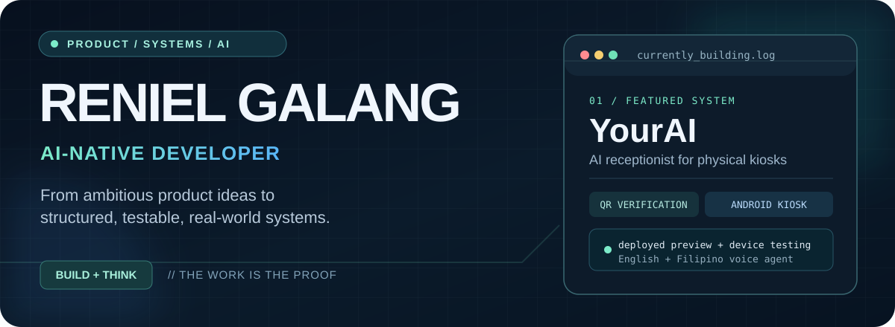
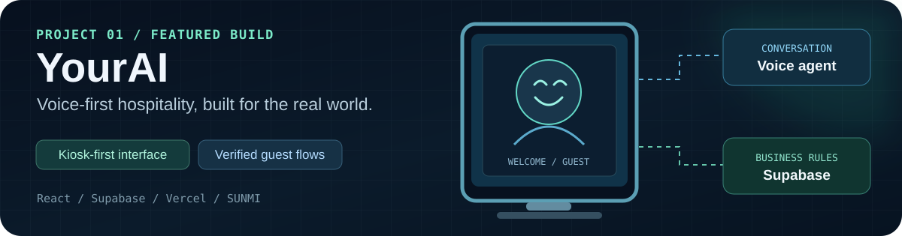
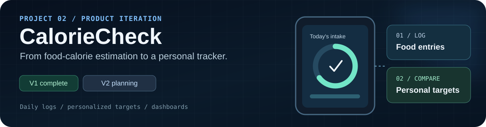
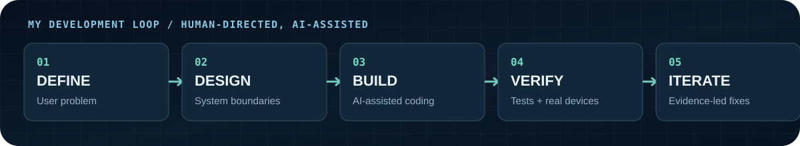

<!--
GITHUB PROFILE README
1. Create a PUBLIC repository named exactly [YOUR_GITHUB_USERNAME].
2. Place this README.md at its root, alongside the assets/ folder.
3. Replace ALL [BRACKETED_PLACEHOLDERS] before publishing.
4. Use real links, publicly verifiable details, and genuine project screenshots as you add them.
5. Keep milestones current; avoid claiming planned integrations are live.
-->

  

  <strong>Product thinking &nbsp;·&nbsp; System design &nbsp;·&nbsp; Applied AI &nbsp;·&nbsp; Real-world testing</strong>

  <a href="https://www.linkedin.com/in/reniel-galang-tech-engr">LinkedIn</a> &nbsp;•&nbsp;
  <a href="mailto:renielgalang.py@gmail.com">Email</a>

## Hey, I'm Reniel Galang.👋

**I turn a product idea into a system you can actually try.**

I'm an **AI-native developer** drawn to conversational AI, interactive web experiences, and software that meets the physical world. I work from the problem outward: define requirements, question architecture, coordinate implementation with AI coding tools, and test the result against real user journeys.

> **My operating principle:** Let AI handle conversation and accelerate development; keep identity, authorization, and critical business rules deterministic.

### ✦ Selected work

#### 01 / YourAI — An AI receptionist that lives on a kiosk

**The challenge:** Make an AI receptionist useful in a physical hospitality environment—not just impressive in a browser demo.

**What I've been building:** A React/TypeScript kiosk interface with avatar states, registration and QR/name verification flows backed by Supabase, and cloud-hosted previews tested on a **SUNMI Flex 3 (27-inch, Android)**.

**The engineering questions:** How do you reduce voice-response latency? Recover gracefully when services fail? Keep an LLM from overriding verification? Make a kiosk experience readable, responsive, and reset-safe?

**Current stage:** Kiosk experience and verification flows implemented and reviewed; **ElevenLabs Agents selected for a modular voice-agent integration**. The managed voice-agent integration is not presented here as complete.

`React` `TypeScript` `Vite` `Supabase` `PostgreSQL` `Vercel` `Android kiosk` `Voice agents (integration planned)`

**Explore:** Private &nbsp;·&nbsp; **Preview:** https://drive.google.com/file/d/1RwHvEZGLBM6TaHkL6OK54yotTTz_8A8e/view?usp=sharing

#### 02 / CalorieCheck — Making food tracking more personal

**The challenge:** Move beyond one-off calorie estimates toward a useful day-to-day food tracking experience.

**What's done:** CalorieCheck V1 was completed and pushed. **What's next:** V2 is being planned around accounts, personalized estimated calorie targets, deliberate food logging, and daily/weekly progress dashboards.

`Food-calorie application` `Product iteration` `Personalization (planned)` `Daily/weekly tracking (planned)`

**Explore:** https://github.com/Reniel-Relearn/calorie-calculator &nbsp;·&nbsp; **Demo:** https://calorie-calculator-gamma-ten.vercel.app/

### ✦ How I build

I use **ChatGPT for research, requirements, and technical reasoning**, and **OpenAI Codex in VS Code for AI-assisted implementation**. My focus is on defining constraints, reviewing outcomes, running practical tests, and deciding what is ready to ship. I don't equate AI-generated code with verified software.

| What I care about | What it means in practice |
| :--- | :--- |
| **AI latency is user experience** | Design for responsiveness, interruptions, and clear states while services process requests. |
| **Trust boundaries matter** | Keep database permissions and identity checks outside free-form model decisions. |
| **Failure paths are product features** | Plan for offline states, mismatches, retries, permission denials, and clean resets. |
| **Real devices reveal real problems** | Validate touch, audio, fullscreen behavior, and readability on target hardware. |

### ✦ Technologies in my projects

| Area | Stack & tools |
| :--- | :--- |
| **Web interface** | `React` `TypeScript` `JavaScript` `Vite` `HTML` `CSS` |
| **Data & services** | `Supabase` `PostgreSQL` `APIs` `Auth` |
| **AI & voice** | `LLM APIs` `STT/TTS concepts` `ElevenLabs Agents (selected)` `Knowledge-base design` |
| **Cloud & delivery** | `Vercel` `Git` `GitHub` `Preview deployments` |
| **Development workflow** | `VS Code` `OpenAI Codex` `ChatGPT` `PowerShell` `Markdown specs` |
| **Devices** | `SUNMI Flex 3` `Android` `Browser-based kiosk UI` |

<strong>↳ The technical problems I'm currently exploring</strong>

 

- **Voice-agent speed:** Time to first audible response, streaming, turn-taking, and interruption handling.
- **Provider independence:** Keeping the product flexible enough to change its voice/LLM provider without rewriting the entire kiosk.
- **Grounded conversations:** Using approved knowledge sources while separating model answers from trusted data operations.
- **AI-assisted engineering:** Better specifications, reproducible tests, architecture reviews, and human acceptance gates.

---

### ✦ Let's make something that works beyond the demo.

I enjoy the space where **product strategy, AI, interfaces, and real-world constraints** meet. If you're building in that space, I'd love to compare notes.

**renielgalang.py@gmail.com** &nbsp;·&nbsp; **https://www.linkedin.com/in/reniel-galang-tech-engr**

Built with curiosity, AI-assisted tools, and a bias toward testing ideas in the real world.
